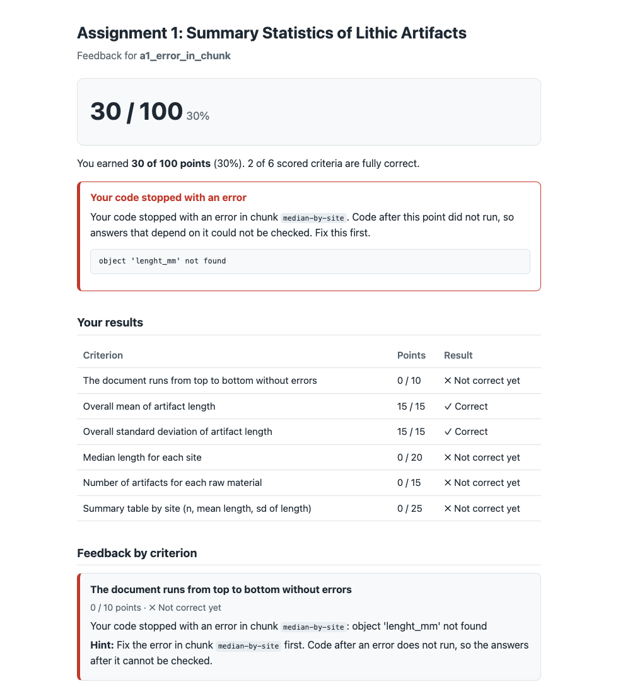

# ArchGrader

[](https://github.com/ashik-ece/ArchGrader/actions/workflows/ci.yaml)


ArchGrader grades student [Quarto](https://quarto.org) (`.qmd`) assignments
written in R. It runs each submission, compares the results the student saved
against the instructor's solution, scores them against a YAML rubric, and writes
a plain-language feedback report for every student plus one `scores.csv` for the
class.

It is **deterministic**: no LLM, no randomness, no web service, no database. The
same rubric and the same submission always give the same score, and every
sentence in a feedback report is text the instructor wrote in the rubric.

It was built for archaeology data-analysis courses, so the bundled assignments
use a synthetic dataset of stone tools: summary statistics, a scatter plot, and a
two-sample comparison.

## Try it in three commands

```sh
git clone https://github.com/ashik-ece/ArchGrader.git && cd ArchGrader
Rscript -e 'install.packages("devtools"); devtools::install_deps(dependencies = TRUE); devtools::install()'
Rscript -e 'ArchGrader::grade_folder("inst/mock_submissions/a1", "a1")'
```

(Quarto must be installed and on the `PATH`; `quarto --version` should work. The
repository is private, so the first command needs a GitHub login.)

```text
ArchGrader batch summary
  Graded:         10 submissions
  Average score:  78.5 / 100 (78.5%)
  With errors:    1
  Total time:     9.3 s (median 0.9 s per submission)
  Scores:         grading-output/scores.csv
  Reports:        grading-output/reports/
```

Grading one file from R shows the score table:

```r
library(ArchGrader)
grade_submission("inst/mock_submissions/a2/a2_half_labeled.qmd", assignment = "a2")
```

```text
ArchGrader: a2_half_labeled | Assignment 2: Visualizing Lithic Artifact Measurements
 criterion     status       credit points
 renders       pass         1.00   10.00/10
 points_layer  pass         1.00   20.00/20
 axes_mapped   pass         1.00   20.00/20
 colour_mapped pass         1.00   15.00/15
 axis_labels   partial      0.50   7.50/15
 title         pass         1.00   10.00/10
 readability   needs_review -      review/10

Score: 82.50 / 90 (91.67%)  + 10 points need TA review
```

A crashing, looping or unreadable submission becomes a normal row and report;
it never stops the batch. Re-running a folder gives an identical CSV apart from
the `seconds` column.

## What a student sees

Each student gets a self-contained HTML report. This one is for a submission whose
code stopped with a typo (`lenght_mm`): the report says which chunk failed, shows
the error, keeps the credit for the work that ran before it, and gives a hint for
each lost criterion.



## A rubric criterion

Everything an instructor decides is in a YAML file: what to check, what it is
worth, how close counts as correct, and what to tell the student. Changing it
never means editing R code. The rubric is validated on load, so a typo gives a
readable error instead of a silently wrong score.

```yaml
- id: median_by_site
  description: "Median length for each site"
  points: 20
  check: value
  params:
    object: median_by_site
    tolerance: 0.01
    key: site              # rows are matched by site, so row order does not matter
  comments:
    pass: "Correct: `{object}` has the right median length for every site."
    partial: "`{object}` is partly right: some sites or columns are wrong or missing."
    fail: "`{object}` does not match the expected table."
  hint: "Group `artifacts` by `site` and take the median of `length_mm`. Save a data frame with columns `site` and `median_length` as `{object}`. Check chunk `{chunk}`."
```

There are six check types.

| Check | Verifies |
|---|---|
| `renders` | The code runs top to bottom without an error or a timeout |
| `value` | A number, vector or table matches the solution within a tolerance |
| `plot` | A saved ggplot has the right geometry, mappings and axis labels |
| `uses_function` | A required function (for example `t.test`) is called in the code |
| `text_mentions` | A written answer under a heading covers the required ideas |
| `manual` | Needs human judgment; listed for the instructor, not scored |

Full details are in [`docs/rubric-format.md`](docs/rubric-format.md).

## How it works

1. **Run.** The student's chunks are extracted and run in a fresh `callr` R
   process in a temporary folder, with a time limit. Results are saved after every
   top-level expression, so an error or a timeout keeps the answers computed
   before it and names the chunk that failed.
2. **Compare.** The instructor's solution is run once and cached. Each criterion
   compares the student's named result objects with the solution's. Students save
   answers under fixed names (`mean_length`, `length_width_plot`, ...), which is
   why a different method that reaches the same answer earns full credit. See
   [`docs/conventions.md`](docs/conventions.md).
3. **Score.** Points are `points x credit`, rounded to two decimals.
4. **Report.** Feedback is assembled from the rubric's `pass`, `partial`, `fail`
   comments and hints, rendered through a Quarto template. Student text is treated
   as untrusted and escaped, so it cannot break or inject into the report.

## Results

Measured by `Rscript data-raw/make_summary.R`, which regenerates
[`results/summary.md`](results/summary.md) with the full tables.

The test of the grader: 30 mock submissions (10 for each of three assignments),
each with a hand-derived expected score for every criterion, **written before the
grader was run**. The mocks include correct answers, valid alternative methods
(which must not be marked down) and one planted mistake each.

| Measure | Result |
|---|---|
| Submission totals matching the answer key | 30 of 30 |
| Criterion-level scores matching the key | 190 of 190 (100%) |
| Valid alternate methods accepted in full | 8 of 8 |
| Planted mistakes scored as predicted | 19 of 19 |
| Code errors reported at the right chunk | 3 of 3 |
| Rubric criteria checked automatically | 19 of 21 (93% of points) |
| Grading time per submission (median, grading only) | 0.1 to 0.4 s |
| Grading time per submission, including the report | about 1 s |
| Test coverage (`covr`) | 94.9% |
| Time to hand-grade the same submissions | **not yet measured** (see below) |

The hand-grading comparison needs a stopwatch run by a person; the protocol and
the ten submissions to time are in [`results/README.md`](results/README.md). Until
it is recorded, this README makes no speed-up claim.

The continuous-integration workflow reruns the grading on every push and fails if
any score differs from the answer key or coverage drops under 80%.
Where the grader and the key were ever in doubt, the record is in
[`docs/disagreement-log.md`](docs/disagreement-log.md).

## Limitations

Please read these before relying on a score.

- **The test data are author-written.** The same person wrote the rubrics, the
  mocks and the answer key. The 100% agreement shows the grader does what the
  rubric says; it does not show the rubric matches another instructor's judgment.
  No real student work has been graded yet. Before trusting it for marks, compare it
  with your own grading on a few real submissions.
- **It grades results, not method or honesty.** A student who types the answer in
  (`mean_length <- 39.046`) earns full credit. Only Assignment 3 uses
  `uses_function`, to require a t-test or linear model.
- **Students must follow the naming convention.** A result saved under a different
  name scores zero for that criterion, and a plot that is drawn but not assigned
  with `<-` cannot be checked. The hint tells the student the name to use.
- **Tolerances can let a near miss through.** In the test set, a Wilcoxon p-value
  within 0.0001 of the t-test's earned the `p_value` points, though the method and
  statistic criteria still lost marks. This is recorded as a known blind spot.
- **Written answers are keyword-checked, not understood.** `text_mentions` confirms
  that the named ideas appear. A wrong conclusion that uses the right words passes
  that check, so reasoning should be a `manual` criterion.
- **Plots are checked as objects, not as pictures.** The `plot` check reads a
  ggplot's layers, mappings and labels. It cannot tell whether a figure is
  readable, and it does not support base R graphics.
- **An empty file earns the `renders` points.** Code that does not run cannot
  fail, so an empty submission scores 10 of 100. Whether `renders` should require
  at least one chunk is an open design decision.
- **It is not a security sandbox.** Each submission runs in its own process with a
  time limit, but student code can still use files and the network as your user.
  Grade only code you trust, or run the grader in a container or virtual machine.
- **Scope.** R and Quarto only, three assignments, one synthetic dataset. Results
  depend on the R and package versions (developed on R 4.6 with ggplot2 4.0).

## Folder layout

| Folder | Contents |
|---|---|
| `R/` | Package code (runner, rubric reader, checks, scorer, feedback, batch runner) |
| `inst/assignments/` | Three assignments (summary statistics, plotting, statistical reasoning), their instructor solutions, and the dataset |
| `inst/rubrics/` | One YAML rubric per assignment |
| `inst/templates/` | Quarto template for the feedback report |
| `inst/mock_submissions/` | 30 mock submissions with `expected_scores.csv` and `planted_mistakes.csv` |
| `data-raw/` | Scripts that generate the dataset and the mocks, and `make_summary.R` |
| `results/` | `summary.md`, per-criterion scores, badges, hand-grading template |
| `docs/` | Instructor guide, conventions, rubric format, disagreement log |
| `tests/testthat/` | Unit and regression tests |
| `.github/workflows/` | Continuous integration |

## Documentation

- [`docs/for-instructors.md`](docs/for-instructors.md): setup, grading a batch,
  reading the output, changing or adding an assignment
- [`docs/rubric-format.md`](docs/rubric-format.md): every rubric field and check
- [`docs/conventions.md`](docs/conventions.md): the object-naming convention and
  each assignment's required objects
- [`docs/disagreement-log.md`](docs/disagreement-log.md): where the grader and the
  hand-derived key were checked against each other

## Requirements

R (4.6 used in development), [Quarto](https://quarto.org), and the R packages in
`DESCRIPTION` (`callr`, `knitr`, `yaml`, `quarto`, `ggplot2`, `rlang`; `dplyr`,
`rmarkdown`, `testthat`, `withr` for the tests and mock submissions).

## License

MIT
